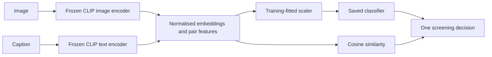

# Multimodal Out-of-Context Misinformation Detection Using Vision-Language Models

**Project and AI-agent handoff — updated 14 November 2026.**

This is a bachelor's data-science project that compares pretrained CLIP representations and lightweight classifiers for screening image–caption pairs for potential out-of-context misinformation. It includes reproducible experiments, data audits, error analysis, and a Streamlit application.

**Read this before continuing:** the three-backbone study is complete. The current app uses an experimentally evaluated **L/14 classifier OR low-similarity rule**, which catches more misleading pairs but increases false alarms. Reliability on unrestricted everyday uploads is **not established**. A proposed new trainable fusion architecture has been discussed but **not implemented or approved for execution**. Do not mistake proposals, older planning notes, or historical classifier results for the current application.

## Contents

1. [Project constraints and objectives](#1-project-constraints-and-objectives)
2. [Current state and handoff priorities](#2-current-state-and-handoff-priorities)
3. [Problem, scope and methodology](#3-problem-scope-and-methodology)
4. [Datasets and acquisition](#4-datasets-and-acquisition)
5. [Architecture and training](#5-architecture-and-training)
6. [Results and interpretation](#6-results-and-interpretation)
7. [Current application](#7-current-application)
8. [Installation and running](#8-installation-and-running)
9. [Transferring to another machine or agent](#9-transferring-to-another-machine-or-agent)
10. [Code and file map](#10-code-and-file-map)
11. [Verification and reproduction](#11-verification-and-reproduction)
12. [Scientific integrity and frozen artifacts](#12-scientific-integrity-and-frozen-artifacts)
13. [Known issues and proposed improvements](#13-known-issues-and-proposed-improvements)
14. [References and contribution](#14-references-and-contribution)
15. [History, cleanup and paused deliverables](#15-history-cleanup-and-paused-deliverables)
16. [Copyable prompt for the next agent](#16-copyable-prompt-for-the-next-agent)

## 1. Project constraints and objectives

| Item | Requirement / observed state |
|---|---|
| Repository | [leanwenjie/DSP](https://github.com/leanwenjie/DSP), published branch `main` |
| Academic level | Bachelor's; originally planned as a 13-week project |
| Title | Fixed; do not silently change it to general image-caption matching |
| Reference-paper preference | 2023–2026; no initial originality requirement, but supervisor subsequently requested a proposed/modified model |
| Budget | Free tools/resources preferred; do not assume paid APIs |
| User hardware | NVIDIA GeForce RTX 4050 Laptop GPU, approximately 6 GB VRAM (6141 MiB reported) |
| Validated runtime | Cloud CPU; laptop GPU and actual Windows launchers not validated |
| Working directory in original cloud | `/workspace/DSP`; this absolute path is not required on another machine |
| User preference | Understand plans before substantial modelling changes; preserve work; explain trade-offs plainly |
| Academic deliverables | Final report/slides paused and archived locally; not current submission-ready documents |

User-approved objectives, verbatim:

1. To compare the effectiveness of selected pretrained vision-language models for out-of-context misinformation detection.
2. To investigate the influence of image–text feature representations on detection performance using machine-learning classifiers.
3. To assess the generalisation and limitations of the developed detection approaches through cross-dataset evaluation and error analysis.
4. To demonstrate an application for screening image–text pairs for potential out-of-context misinformation.

[OBJECTIVES_AND_PLAN.md](docs/OBJECTIVES_AND_PLAN.md) preserves the approved wording. Some of its body describes earlier pending work; its dated completion updates and this README supersede those old status statements. Do not automatically rerun its original remaining-work sequence.

## 2. Current state and handoff priorities

| Work | State |
|---|---|
| NewsCLIPpings annotations and historical cached embeddings | Acquired and audited in original workspace |
| Required VisualNews images | All 71,966 downloaded and verified |
| VERITE image uploads and annotations | Reconciled; all 1,001 released pairs retained |
| Initial B/32 similarity, LR and MLP studies | Complete |
| Matched MLP concatenation/interaction experiment | Complete; fixed-budget limitation documented |
| Fresh B/32, B/16 and L/14 features and LR selection | Complete |
| Frozen three-backbone NewsCLIPpings and VERITE evaluation | Complete |
| Current unified L/14 app, package and follow-up evaluation | Complete; known accuracy limitations remain |
| Proposed similarity-guided trainable fusion network | Discussion only; no implementation/training |
| Broader general image–caption training data | Suggested only; not acquired/adopted |
| Independent everyday-image challenge dataset | Preparations were reverted at user request; no completed challenge set |
| Browser extension, public hosting, GPT/Claude comparison | Discussed only; not implemented/evaluated |
| Final report/slides | Paused; old sources and generated files archived locally |
| Cleanup | Completed 2026-11-14; no model/code behaviour change |

**First actions for a new agent:** inspect Git status, determine whether ignored datasets/artifacts transferred, read the current app and unified-screening report, run appropriate checks, and identify the user's next requested task. No new training phase is implicitly authorised by this handoff. An app-only clone can be restored from the included ZIP without downloading benchmark datasets.

## 3. Problem, scope and methodology

An authentic image may be paired with a caption that refers to a different event or context. An obvious visual mismatch is relevant to screening, but a visually plausible pairing may still be factually wrong. Conversely, low similarity can reflect an indirect caption, joke, or unfamiliar content rather than misinformation.

The project predicts dataset-defined genuine versus misleading pairings. It does **not** retrieve original sources, independently verify dates/locations, or establish factual truth. The user initially wanted unrestricted uploads; real failures revealed that this broader capability is not validated. Recommended core evaluation remains news-pair screening on NewsCLIPpings and external evaluation on VERITE.

CRISP-DM mapping:

| Stage | Implemented work |
|---|---|
| Business understanding | Assist review of potentially misleading image–text pairs; human review remains necessary |
| Data understanding | Split/class audits, image coverage, source/caption summaries, similarity error groups |
| Data preparation | Map image/caption IDs; validate downloads; consistent CLIP preprocessing; normalised embeddings |
| Modelling | Frozen encoders, feature representations, train-fitted scalers, LR/MLP, similarity baseline |
| Evaluation | Validation selection, frozen test/external metrics, grouped intervals and error analysis |
| Deployment | Local Streamlit app and app-only ZIP; software validation and limited CPU timing |

The project has empirical and implementation contributions. It does not yet contain a newly invented pretrained model or a demonstrated superior alternative to general-purpose multimodal assistants.

## 4. Datasets and acquisition

| Dataset | Role | Used size | Local location |
|---|---|---|---|
| NewsCLIPpings Merged/Balanced | Training, validation and test pair definitions | 71,072 train; 7,024 validation; 7,264 test; balanced classes | `data/newsclippings/` |
| VisualNews | Original image/caption source for those pairs | 71,966 distinct required images; metadata has 1,259,732 IDs | `data/visualnews/` |
| VERITE | External evaluation; no training/threshold selection | 1,001 pairs, 663 unique images | `data/verite/` |
| 5Pils-OOC | Optional incomplete extension | Unscored; not part of main reported results | `data/5pils_ooc/` |
| ARO annotations | Historical feasibility investigation | No completed model evaluation | `data/research_options/` |

Sources:

- [NewsCLIPpings repository](https://github.com/g-luo/news_clippings) and [dataset](https://huggingface.co/datasets/g-luo/news_clippings).
- [VisualNews repository](https://github.com/FuxiaoLiu/VisualNews-Repository), [official website](https://www.cs.rice.edu/~vo9/visualnews/), [community metadata mirror](https://huggingface.co/datasets/twelcone/VisualNews).
- [VERITE dataset](https://huggingface.co/datasets/stefpapad/VERITE) and [authors' repository](https://github.com/stevejpapad/image-text-verification).

### Important provenance and storage details

NewsCLIPpings references image/caption IDs; original images come from VisualNews. Labels and IDs are not predictive features. An image can participate in multiple pairs, so image counts and pair counts differ. The audit found no shared VisualNews IDs across the selected main splits.

The official VisualNews `origin.tar` is approximately **98 GB**. Do not download the whole archive into the user's limited storage. The existing range downloader scanned it incrementally and retained only required images, approximately 3 GB locally. A full scan still consumed substantial network transfer. Metadata came from the pinned community mirror: all required IDs were covered, and 40,830 existing official validation records matched captions/paths; this does not authenticate the mirror as byte-identical to an official metadata release. See [VISUALNEWS_ACCESS.md](docs/VISUALNEWS_ACCESS.md) and the VisualNews audit JSON files.

VERITE labels: **338 true, 338 miscaptioned, 325 out-of-context**. The public annotations have 1,001 rows despite common descriptions of 1,000; do not discard a row to match the description. Evaluate separately:

- Primary: 338 true + 325 out-of-context = **663 pairs**.
- Secondary: all misleading categories versus true = **1,001 pairs**.

The user's uploaded images are retained locally; that copy needs no HF token. Fresh source access may have conditions—inspect the current source rather than assuming a credential is required. Never paste tokens into chat or commit them. Dataset availability at the source can change.

## 5. Architecture and training

### Frozen encoders

| CLIP backbone | Patch size | Output dimensions per modality |
|---|---:|---:|
| ViT-B/32 | 32 × 32 | 512 |
| ViT-B/16 | 16 × 16 | 512 |
| ViT-L/14 | 14 × 14 | 768 |

These are three backbones of **one model family**, not three independent VLM families. Larger backbones differ in several ways; results do not isolate patch size alone. Standard OpenAI preprocessing is applied consistently in the fresh pipeline. Embeddings are float32 and L2-normalised. CLIP weights are not fine-tuned.



The last cosine branch is combined with the classifier only for the current default L/14 app. Original classifier-only research results remain separate.

### Features and classifiers

For normalised image/text vectors `v` and `t`:

- Concatenation: `[v, t]`, dimension `2d`.
- Interactions: `[v, t, abs(v-t), v*t, cosine(v,t)]`, dimension `4d+1`.
- Interaction dimensions: 2,049 for B/32 and B/16; 3,073 for L/14.

`StandardScaler` is fitted on training features only. The final fresh-backbone comparison uses logistic regression, `C ∈ {0.001, 0.01, 0.1}`, `lbfgs`, maximum 1,000 iterations, tolerance `1e-5`. Both feature representations are evaluated during validation selection. Validation macro-F1 selects settings and decision threshold. Selected interaction-head C values: B/32 `0.001`, B/16 `0.001`, L/14 `0.01`.

MLP studies belong to the earlier cached-B/32 branch; do not describe them as the same fresh three-backbone experiment. Their representation follow-up uses seeds 42/43/44 and a matched training budget. See [MLP reports](reports/mlp/README.md) and [concatenation comparison](reports/mlp_concat/README.md).

Saved `.npz` heads contain scaler means/scales, feature mode, weights/biases and threshold. Logistic inference returns a decision score. The internal threshold helper uses negated classifier scores; `classify_vectors()` converts the stored threshold back before comparing. Do not change signs casually. Numeric inference is centralised in `scripts/model_inference.py`.

### Why fresh features exist

Initial experiments used released cached B/32 embeddings. Fresh image features did not exactly match them. Six fixed preprocessing variants did not resolve that discrepancy. We therefore extracted fresh training/validation/test/app-compatible features rather than claim original cached-image parity. Historical cached results remain valid for their recorded inputs but are a separate experiment family. See [preprocessing diagnosis](reports/encoder/PREPROCESSING_DIAGNOSIS.md).

## 6. Results and interpretation

### Original fresh-backbone interaction classifiers

| Backbone | NewsCLIPpings accuracy | NewsCLIPpings macro-F1 | VERITE primary macro-F1 | VERITE all-misleading macro-F1 |
|---|---:|---:|---:|---:|
| B/32 | 69.67% | 69.67% | 67.65% | 52.77% |
| B/16 | 78.21% | 78.21% | 69.00% | 53.19% |
| L/14 | 83.63% | 83.62% | 73.88% | 53.77% |

L/14 was the validation-leading candidate before its final evaluation. See [complete comparison](reports/backbone_evaluation/RESULTS.md), per-task JSON files, and paired intervals. Grouped bootstraps use 2,000 draws, seed 42, and groups reflecting shared IDs/stories. Intervals are conditional on the evaluated models and exploratory; do not imply all pairwise differences or cross-paper claims were statistically established.

### Current unified L/14 app versus original classifier

| Dataset/task | Original macro-F1 | Unified macro-F1 | Original recall | Unified recall | Added detections | Added false alarms |
|---|---:|---:|---:|---:|---:|---:|
| NewsCLIPpings test | 83.62% | 81.86% | 81.58% | 86.23% | 169 | 295 |
| VERITE primary | 73.88% | 74.98% | 55.69% | 59.69% | 13 | 8 |
| VERITE all misleading | 53.77% | 55.60% | 34.09% | 37.71% | 24 | 8 |

NewsCLIPpings false alarms increase from 520 to 815. This is a recall/false-alarm trade-off, not an across-the-board improvement. **Do not advertise 83.62% macro-F1 as the current unified app's score.** See [unified evaluation](reports/unified_screening/README.md).

Other completed evidence: cached B/32 MLP seed-42 test macro-F1 rose from 60.35% for concatenation to 68.86% for interactions (+8.51 percentage points). All concatenation seeds hit the 30-epoch budget; this does not establish optimised-model superiority. In the earlier hardest validation similarity group, LR detected 35/300 misleading pairs and MLP 46/300, illustrating semantic compatibility despite incorrect context.

Both benchmark test datasets have already been inspected. New experiments are follow-ups. A new untouched confirmatory claim requires a separately reserved suitable evaluation set; repeated tuning on these results is not allowed to masquerade as held-out testing.

## 7. Current application

`app.py` calls `validate_input()` and `Detector.predict()` in `scripts/app_inference.py`. The detector loads CLIP, normalises embeddings, calls saved numeric inference, and applies the screening decision. It does not learn from uploads.

| Menu option | Actual behaviour |
|---|---|
| CLIP L/14 + logistic regression (default) | Original L/14 classifier OR same-backbone low similarity |
| Logistic regression | Historical B/32 classifier |
| CLIP similarity | Historical B/32 threshold baseline |
| MLP seed 42 | Historical B/32 MLP |

B/16 is not an app menu option. All model heads are hash-checked during initialisation; the default can fail if legacy heads are missing.

Default rule, using full precision in code:

```text
flag = (classifier_score > -0.004028608531695233)
       OR (CLIP_cosine < 0.2376762482060819)
```

The interface shows one flag/no-flag verdict, analysis time and an explanation expander. Technical details expose the fixed rule, not two separate user-facing assessments. Scores are not calibrated truth probabilities. The cosine threshold is loaded from hash-verified L/14 development metrics.

Inputs: still JPEG/PNG/WebP, up to 10 MB and 20 megapixels; nonempty caption within CLIP's 75-text-token budget. The app rejects long captions, while VERITE benchmark extraction uses its documented truncation policy. Uploads are processed in server memory without application-level saving or an external prediction API. The host must be trusted.

CPU inference is explicit. One encoder is retained at a time. Switching backbones reloads the encoder. Displayed time excludes initial loading, upload/validation and waiting for the inference lock. No production concurrency or public-service guarantees.

## 8. Installation and running

### Already prepared original cloud workspace

```bash
cd /workspace/DSP
.venv/bin/python -m pip check
.venv/bin/python -m unittest discover -s tests -q
.venv/bin/python -m streamlit run app.py --server.address 127.0.0.1 --server.port 8501
```

The server process does not survive environment suspension/restoration. Do not confuse saved environment configuration with successful platform publication. A publish-status error was reported earlier; working app tests do not prove platform publication or fresh-task restoration.

### New Linux/CPU checkout

Python 3.12 and Git are the recommended starting tools. Existing tested packages are pinned in the layered requirements. Commands below reproduce the intended setup; a fresh machine must still be validated.

```bash
git clone https://github.com/leanwenjie/DSP.git
cd DSP
python3.12 -m venv .venv
.venv/bin/python -m pip install --no-cache-dir torch==2.7.1 torchvision==0.22.1 --index-url https://download.pytorch.org/whl/cpu
.venv/bin/python -m pip install --no-cache-dir -r requirements-app.txt
.venv/bin/python -m pip check
```

Restore the small trained heads before inference. The ZIP below already contains them. From the repository root, this snippet copies only missing heads, verifies packaged hashes, and refuses to overwrite different existing heads:

```python
# Run with the project's Python from the repository root.
import hashlib
import json
from pathlib import Path
from zipfile import ZipFile

heads = [
    "artifacts/backbones/ViT-L-14/best_model.npz",
    "artifacts/logistic/best_model.npz",
    "artifacts/mlp/model_seed42.npz",
]
with ZipFile("exports/DSP-app-Windows.zip") as archive:
    hashes = json.loads(archive.read("DSP-app/SHA256SUMS.json"))
    for name in heads:
        payload = archive.read("DSP-app/" + name)
        assert hashlib.sha256(payload).hexdigest() == hashes[name], name
        target = Path(name)
        if target.exists():
            assert target.read_bytes() == payload, "Different existing head: " + name
        else:
            target.parent.mkdir(parents=True, exist_ok=True)
            target.write_bytes(payload)
```

All other required runtime source/JSON files are tracked in the repository. CLIP downloads official checksum-verified weights on first use: approximately 890 MiB for L/14 and 338 MiB for B/32. No benchmark download is needed for personal uploads. Allow sufficient RAM/disk; a fresh Codespaces/hosted deployment has not been validated here.

### Windows app-only route

1. Install Python 3.12 (64-bit, with launcher) and Git for Windows.
2. Download [DSP-app-Windows.zip](https://github.com/leanwenjie/DSP/raw/refs/heads/main/exports/DSP-app-Windows.zip).
3. Extract the entire folder; retain its structure.
4. Run `setup_windows.bat`, then `start_app.bat`.
5. Follow `START_HERE.txt`; keep the server terminal open.

The packaged Python runtime path was tested on cloud CPU, including a real-model form submission. **Windows batch execution and RTX 4050 acceleration remain untested.** CUDA is not enabled by this package. Do not copy `.venv` between operating systems.

## 9. Transferring to another machine or agent

**GitHub alone is not a backup of the full research workspace.** Another agent will not automatically receive the conversation, cloud snapshot, datasets, predictions, credentials or running services.

| Transfer goal | What to transfer |
|---|---|
| Understand code/results | Git clone; this README; linked reports/docs |
| Run app on new uploads | Clone plus three small heads from app ZIP; dependencies; download/restore CLIP checkpoint |
| Reproduce numerical evaluation | Above plus relevant `data/` annotations and `artifacts/` features/predictions/provenance |
| Continue extraction/training | Full `data/` and `artifacts/` trees with receipts/manifests, in addition to source |
| Resume old academic drafts | Local paused-deliverables archive; review its historical content before using |
| Reuse demo pack | Local `exports/DSP-demo-examples.zip`; not in GitHub |

Recommended private research transfer: preserve `data/` and `artifacts/` with relative paths intact, plus any needed local exports. Compare file hashes after copying. These are several GB; check source/destination capacity first. Do not publish dataset images, secrets, or large research artifacts to GitHub. Rebuild `.venv` on the destination.

Runtime-critical files:

```text
app.py
.streamlit/config.toml
scripts/app_inference.py
scripts/model_inference.py
scripts/prepare_data.py
artifacts/backbones/ViT-L-14/best_model.npz
artifacts/logistic/best_model.npz
artifacts/mlp/model_seed42.npz
reports/baseline/metrics.json
reports/backbone_comparison/ViT-L-14/metrics.json
reports/newsclippings_test/frozen_manifest.json
reports/backbone_evaluation/frozen_manifest.json
artifacts/clip/ViT-L-14.pt                 # or download on first use
artifacts/clip/ViT-B-32.pt                 # for legacy options
```

Other important local research paths:

```text
data/newsclippings/{train,val,test}.json
data/newsclippings/embeddings/
data/visualnews/data.json
data/visualnews/downloaded_images.jsonl
data/visualnews/origin/
data/verite/VERITE.csv
data/verite/images/
artifacts/fresh_clip/
artifacts/backbones/
artifacts/backbone_evaluation/
artifacts/verite/
artifacts/newsclippings_test/
artifacts/mlp_concat/
```

An agent opening an app-only checkout must report missing research inputs rather than silently retrain replacement models or claim evaluation ran. A source clone does not carry the original cloud's network settings or optional HF secret binding. Normal app inference needs no API key.

## 10. Code and file map

Full guide: [FILE_GUIDE.md](docs/FILE_GUIDE.md). The [inventory](docs/FILE_INVENTORY.csv) is a dated scoped snapshot; [scope definition](docs/INVENTORY_SCOPE.md) explains omissions. It is not a per-image or live filesystem listing.

| File/group under `scripts/` | Purpose |
|---|---|
| `app_inference.py` | Input checks, model verification, CLIP encoding and unified decision |
| `model_inference.py` | Feature construction, saved scaling and LR/MLP calculations |
| `prepare_data.py` | Pinned preparation/audits and shared paths/hash helpers; main also includes 5Pils |
| `download_visualnews.py`, `audit_visualnews_download.py` | Resumable bounded-range acquisition and coverage audit |
| `prepare_verite_upload.py` | Split-archive assembly, safe image extraction and coverage |
| `audit_embeddings.py` | Historical official feature integrity/coverage |
| `visualnews_eda.py` | Descriptive EDA, plot and local image gallery |
| `similarity_baseline.py` | Historical development loaders and validation threshold selection |
| `train_logistic.py`, `train_mlp.py` | Cached-feature studies; helpers re-exported for compatibility |
| `train_fresh_clip.py`, `audit_fresh_clip.py` | Fresh B/32 extraction/training and audit |
| `train_clip_backbones.py` | Fresh B/16 and L/14 extraction/training, per-representation winners |
| `profile_clip_backbone.py` | Fixed small-sample CPU runtime/memory profile |
| `verify_clip_encoder.py`, `verify_verite_features.py`, `diagnose_clip_preprocessing.py` | Encoder/preprocessing compatibility investigations |
| `evaluate_newsclippings_test.py`, `evaluate_verite.py` | Historical cached-model evaluations and grouped-metric helpers |
| `evaluate_mlp_concat.py` | Matched MLP representation follow-up |
| `evaluate_clip_backbones.py` | Main frozen three-backbone evaluation with resumable extraction |
| `evaluate_unified_screening.py` | Fixed OR-rule evaluation and regression/parity checks |
| `analyse_similarity.py`, `compare_thresholds.py` | Error groups and validation recall operating points |
| `report_verite.py`, `report_backbones.py` | Format saved results; no new training |
| `check_app.py` | Legacy B/32 parity/timing; can rewrite its historical timing report |
| `check_l14_app.py` | Current L/14 classifier parity and unified raw-input checks |
| `collect_5pils_images.py`, `process_5pils_images.py` | Optional incomplete extension; keep its third-party licence with adapted code |

`tests/` covers upload/interface behaviour, feature arithmetic, saved inference, threshold boundaries, grouping/bootstrap logic and downloads. `data/` holds datasets; `artifacts/` holds weights/features/predictions; `reports/` holds evidence; `outputs/` holds local generated material. `.git/` and `.venv/` are not authored research code.

Do not remove old training modules merely because the app no longer imports them: historical evaluators/tests still import some helpers. Do not remove all 5Pils data without adjusting `prepare_data.py`'s optional preparation/audit coupling.

## 11. Verification and reproduction

Latest cleanup verification: **32 tests passed**, dependencies healthy, detector initialisation passed, and all **43 files in the fresh-backbone frozen manifest** retained their hashes. This verifies software/environment integrity, not universal detection accuracy.

Routine checks:

```bash
.venv/bin/python -m pip check
.venv/bin/python -m unittest discover -s tests -q
```

Research integration checks, **only with retained data/features**:

```bash
.venv/bin/python scripts/check_l14_app.py
.venv/bin/python scripts/evaluate_unified_screening.py
# Optional illustrative input, not a new accuracy estimate:
.venv/bin/python scripts/evaluate_unified_screening.py --banana-image /path/to/banana.jpg
```

These write current follow-up reports; inspect Git diff afterwards and preserve earlier evidence when changing an experiment. Do not run `check_app.py` expecting an L/14 test: it checks legacy routes and rewrites its own timing report.

Recorded unified checks: 8,265 cached NewsCLIPpings/VERITE predictions, six raw VERITE pairs, 32 software tests, ZIP CRC/payload hashes and extracted-package real-model Streamlit submission. Unit UI tests use controlled detector outputs; the separate integration check used real CLIP inference. Windows/browser usability/load tests remain distinct and incomplete.

Training entry points are listed for understanding, **not an instruction to run**:

- `train_fresh_clip.py`: existing B/32 development outputs.
- `train_clip_backbones.py 'ViT-B/16'` or `'ViT-L/14'`: existing fresh studies.
- `train_mlp.py`: historical cached-feature study.

Some scripts refuse completed outputs; others overwrite artifacts. Resumption validates provenance. Never launch them casually in an existing evaluated directory. Define new output directories/protocols for intentional new studies before executing. Do not edit a script while it is running.

## 12. Scientific integrity and frozen artifacts

- Select settings, scaling and thresholds using training/validation only; do not tune on VERITE or test examples.
- Preserve model weights, label meanings, split membership and evaluation protocols.
- Do not call false-positive fixes on inspected examples untouched improvements.
- Never use true context, ground-truth captions, labels, or identifiers as prediction inputs.
- Do not relabel misinformation benchmarks as visual-consistency ground truth.
- Frozen manifests bind scripts, parameters and data. Do not alter expected hashes to make a failed check pass.
- Keep original classifier and unified-rule scores clearly distinguished.
- Preserve historical result files. New experiments need distinct names, provenance and limitations.
- Use validation-selected candidates, not the best test result or most flattering random seed.
- Report complete metrics, failures and false alarms, not only a selected successful demo.

The B/16/L/14 trainer had a documented resume fix for memory addresses in preprocessing function representations. The original B/16 trainer copy remains at `artifacts/backbones/trainer_before_resume_fix.py`; [resume_fix.json](reports/backbone_comparison/resume_fix.json) records migration. Do not delete it as an apparent duplicate.

## 13. Known issues and proposed improvements

### Unresolved banana false positive

The user ran L/14 on an image of a bunch of bananas on a wooden background with “its a banana” and reported a flag. That attachment was visible in chat but its bytes were not available to the cloud shell; the user's `C:/Users/User/Downloads/banana.jpg` is not a cloud path. Exact classifier/cosine scores were not supplied. **The exact failure has not been reproduced or fixed.**

A different public image, Banana-Single.jpg, was tested: matching fruit captions were accepted; “i am human” changed from accepted by the original classifier to flagged by the OR rule. A later check accepted “its a banana” on that substitute. These do not establish performance on the user's photo. First-person language may refer to the poster, so it is not unambiguous misinformation ground truth.

### Proposals, not completed work

The supervisor requested an identifiable proposed/modified model. Discussed candidate: a small similarity-guided interaction network with a trainable interaction branch, separate cosine branch and learned fusion. Frozen CLIP L/14 features would be reused. This has **not** been implemented, trained, adopted as a final model or established as novel. Existing interaction features already include cosine; simply duplicating it is not a strong contribution.

Suggested future comparisons: original LR, ordinary MLP, proposed model, proposed model without similarity branch, and current fixed OR rule. Broader training on appropriately licensed general image–caption data was suggested, but no dataset/protocol has been adopted. Separate architecture effects from additional-data effects and use matched development budgets/seeds.

A structured behavioural evaluation (correct paraphrases, obvious mismatches, plausible contextual misuse, modest image changes) was discussed. The user twice stopped/reverted everyday-challenge work and separate compatibility UI. Do not recreate that paused work silently. The accepted implementation is one unified result. The small banana diagnostic is not a challenge benchmark.

Browser extension, SigLIP/BLIP-family alternatives, fine-tuning/LoRA, and GPT/Claude baseline comparisons were discussed only. None should be described as completed. EXAMS-V was inspected and rejected as a direct benchmark because exam QA differs from pair classification. ARO/SugarCrepe were suggested only as possible diagnostics.

### Recommended next decision

Agree with the user on the next modelling/evaluation phase before training. First establish whether the goal is the manageable news-screening scope or broader arbitrary-upload reliability. Then predefine a proposed-model comparison and suitable development/evaluation data. Do not promise a new architecture will solve missing factual evidence. The current benchmark study can be academically useful even though the unrestricted-upload product remains unreliable.

For a panel, use complete NewsCLIPpings/VERITE results plus a few successful and failed examples and input validation. No need to adopt every optional extension to complete the project.

## 14. References and contribution

**Main reference:** Shalabi, F., Nguyen, H. H., Felouat, H., Chang, C.-C., & Echizen, I. (2023). *Image-Text Out-Of-Context Detection Using Synthetic Multimodal Misinformation*. APSIPA ASC. [DOI](https://doi.org/10.1109/APSIPAASC58517.2023.10317336), [accessible manuscript](https://arxiv.org/abs/2403.08783).

The paper shares the Merged/Balanced benchmark and CLIP B/32 foundation but generates additional captions/images and uses Sentence-BERT and a separate vision Transformer. Our direct interaction-feature pipeline does not reproduce that method. Its reported 68% accuracy and our higher L/14 result are not a controlled proof that our architecture is superior: encoder, inputs, features and settings differ. The paper describes pretrained feature extraction; do not claim explicit freezing of every component beyond what its text/code establishes.

Other relevant work:

- [NewsCLIPpings, EMNLP 2021](https://aclanthology.org/2021.emnlp-main.545/): benchmark construction.
- [VisualNews, EMNLP 2021](https://aclanthology.org/2021.emnlp-main.542/): original news images/captions.
- [VERITE](https://doi.org/10.1007/s13735-023-00312-6): real-world evaluation and dataset-bias concerns.
- [Similarity over Factuality, WACV 2025](https://openaccess.thecvf.com/content/WACV2025/html/Papadopoulos_Similarity_over_Factuality_Are_we_Making_Progress_on_Multimodal_Out-of-Context_WACV_2025_paper.html): similarity/representation baselines and evaluation cautions.
- [RED-DOT](https://doi.org/10.1109/TCSS.2025.3553939): related evidence-based work; **not the current main reference**.
- [COVE, NAACL 2025](https://aclanthology.org/2025.naacl-long.102/): evidence/context-based approach, not implemented here.

See [literature review](docs/LITERATURE_REVIEW.md) for prior review notes; dataset-availability statements there may predate completed downloads. Verify original sources and bibliography details before final APA submission.

Current defensible contributions: controlled backbone comparison, representation experiments, cross-dataset/error analysis, and an evaluated local screening application. CLIP, LR, MLP, standard interaction operations and OR rules are not inventions of this project. No state-of-the-art or GPT/Claude-superiority claim is established.

## 15. History, cleanup and paused deliverables

Milestones:

- `990cbca`: reference alignment and matched MLP feature study.
- `0fd858f`: complete fresh backbone evaluations and L/14 app/package.
- `3a94f7a`: unified screening rule and its evaluation.
- `aa79b17`: current-file documentation and verified workspace cleanup.
- This README handoff is a subsequent documentation update; use `git log -1` for the actual current revision.

Cleanup on 2026-11-14 removed approximately **918 MiB** of unused Playwright browser binaries and caches. Python caches can reappear during tests. No application behaviour, dataset, model, test prediction or frozen protocol changed. [Cleanup record](docs/CLEANUP_2026-11-14.json) includes hashes, paths and validation. Earlier cleanup log remains intact.

Eight paused source/generated deliverables were hash-verified into **local, ignored** `exports/paused-deliverables-2026-11-14.zip` before loose copies were removed. It includes `docs/PROJECT_REPORT.md`, `docs/PRESENTATION.md`, `scripts/build_submission.py`, `requirements-deliverables.txt`, and generated submission files. Extract separately for inspection; the old generator can overwrite documents with superseded results. Do not assume these drafts exist after a Git clone.

`exports/DSP-demo-examples.zip` is another local-only export with four VERITE images and six labelled cases; one is a known miss. It is for the user's demonstration, not an independent accuracy estimate, and is not uploaded to GitHub.

Historical docs: [project history](docs/archive/PROJECT_HISTORY.md), [old file guide](docs/archive/FILE_GUIDE_2026-11-08.md), [app history](reports/app/HISTORY.md). Use current source, numeric reports and this handoff to resolve old “pending” statements. User corrections override this document; ask when conflicting evidence affects a decision.

## 16. Copyable prompt for the next agent

> Continue my bachelor's project in leanwenjie/DSP. First read README.md completely, then docs/FILE_GUIDE.md, reports/app/README.md, reports/backbone_evaluation/RESULTS.md and reports/unified_screening/README.md. Inspect actual files and Git status before making changes. The fixed title is “Multimodal Out-of-Context Misinformation Detection Using Vision-Language Models.” Three frozen CLIP backbone studies are complete. The current default app uses L/14 logistic regression OR its existing similarity baseline; it has a measured recall/false-alarm trade-off and unresolved everyday-image failures. Do not claim it reliably verifies arbitrary uploads or dates/locations. A proposed trainable fusion architecture is discussion only; explain the next modelling plan before implementing it. Preserve original evaluations, thresholds, manifests and historical experiments. Check whether ignored data/artifacts transferred; GitHub alone is insufficient for research reproduction, but the app ZIP contains the small trained heads. Do not silently retrain missing models or overwrite hashes. Keep report/slides work paused unless I resume it. Do not assume the previous chat, cloud services or credentials transferred. Report what is verified, missing, proposed and unresolved, then continue my next explicit task.
