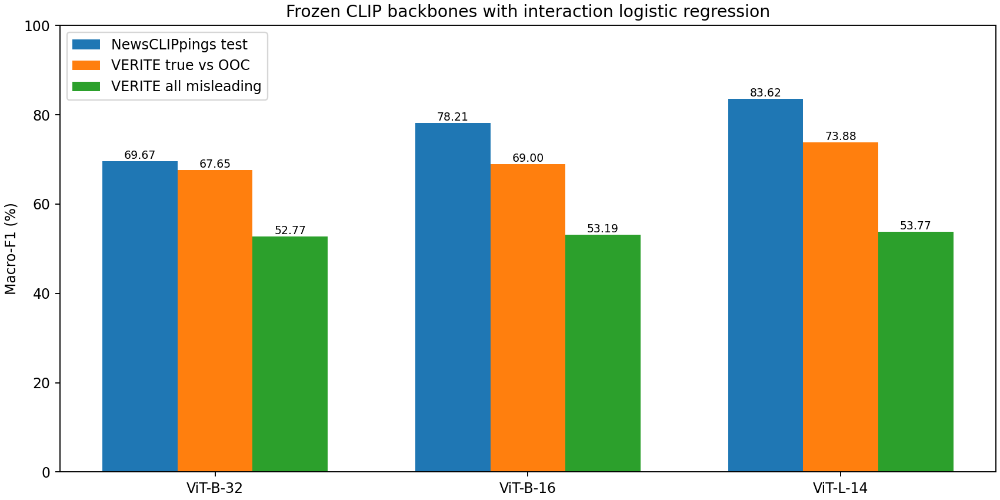

# Frozen backbone comparison — completed

All three candidates use freshly extracted standard-CLIP features and validation-selected interaction logistic regression. This is follow-up evaluation after prior benchmark inspection; no test-based tuning was performed.

| Backbone | NewsCLIPpings accuracy | NewsCLIPpings macro-F1 | VERITE primary macro-F1 | VERITE OOC recall | VERITE all-misleading macro-F1 |
| --- | ---: | ---: | ---: | ---: | ---: |
| ViT-B-32 | 69.67% | 69.67% | 67.65% | 52.31% | 52.77% |
| ViT-B-16 | 78.21% | 78.21% | 69.00% | 52.00% | 53.19% |
| ViT-L-14 | 83.63% | 83.62% | 73.88% | 55.69% | 53.77% |

L/14 had the highest validation macro-F1 before test scoring. It also has the highest reported point estimates here, but the broader VERITE task remains weak. Test scores do not establish factual verification of arbitrary uploads. All-misleading VERITE is imbalanced; accuracy alone is insufficient.

## Paired differences relative to fresh B/32

| Task | Backbone | 95% interval of macro-F1 change (percentage points) |
| --- | --- | --- |
| newsclippings_test | ViT-B/16 | +7.55 to +9.55 |
| newsclippings_test | ViT-L/14 | +12.89 to +15.05 |
| verite_primary_true_vs_ooc | ViT-B/16 | -2.27 to +4.77 |
| verite_primary_true_vs_ooc | ViT-L/14 | +2.41 to +10.14 |
| verite_secondary_all | ViT-B/16 | -2.15 to +2.87 |
| verite_secondary_all | ViT-L/14 | -1.55 to +3.57 |

Intervals use 2,000 paired grouped-bootstrap draws with seed 42. They are exploratory and not multiplicity-adjusted. L/14 has a positive interval versus fresh B/32 on NewsCLIPpings and primary VERITE, but not on all-misleading VERITE. No interval here compares L/14 directly against B/16.

Full task JSON files include confusion matrices, ranking metrics, category counts and caption truncation counts. VERITE truncation matches the recorded evaluation policy; the app rejects overly long captions instead. Protocol and frozen manifest remain unchanged. Raw predictions are stored in ignored artifacts/backbone_evaluation.

These results address backbone effectiveness and external generalisation. They do not replace the separate representation-ablation evidence or constitute reproduction of the main reference paper. App integration uses the validation-leading L/14 candidate; its costs and weaker secondary result must be disclosed.
