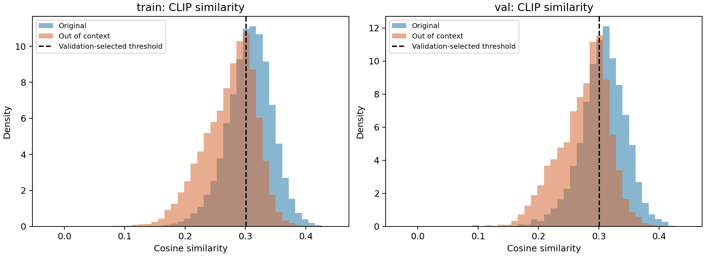
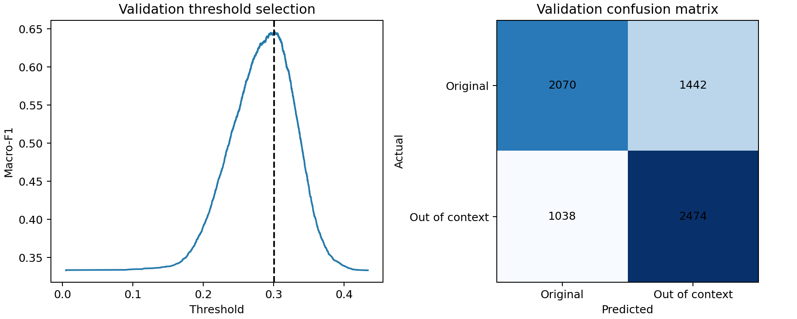

# CLIP similarity baseline — development results

Uses official frozen CLIP ViT-B/32 embeddings from NewsCLIPpings `merged_balanced`. L2-normalise both modalities, then compute cosine similarity. Predict out of context when similarity is below **0.3007060646524869**.

The threshold maximises macro-F1 on the **validation set only**. Exact tied scores are kept together; equal optima choose the lowest threshold. No classifier weights are trained. Test predictions have not been generated for either NewsCLIPpings or 5Pils-OOC.

| Metric | Train (diagnostic) | Validation (threshold selection) |
| --- | ---: | ---: |
| Pairs | 71,072 | 7,024 |
| Macro-F1 | 0.6438 | 0.6458 |
| Accuracy | 0.6450 | 0.6469 |
| Out-of-context precision | 0.6301 | 0.6318 |
| Out-of-context recall | 0.7025 | 0.7044 |
| ROC-AUC (negative similarity) | 0.7128 | 0.7128 |

Validation results are optimistically selected because that split determines the threshold. They are not an unbiased generalisation estimate, a reproduction of COVE's results, or evidence of real-world misinformation verification.

Validation confusion matrix (rows actual, columns predicted; original first): `[[2070, 1442], [1038, 2474]]`. This means 1,442 original pairs were flagged incorrectly and 1,038 misleading pairs were missed.

## Visual story



Original pairs tend to have higher similarity, but the distributions overlap substantially. Semantic resemblance alone does not reliably distinguish correct context from misleading context. Test whether learned multimodal features improve this baseline; improvement is not guaranteed.



## Reproduce

From the repository root:

```bash
.venv/bin/python -m pip install --no-cache-dir -r requirements-models.txt
.venv/bin/python -m unittest discover -s tests -v
.venv/bin/python scripts/similarity_baseline.py
```

`metrics.json` records full metrics, decision rule, and input SHA256 hashes. Per-pair predictions are under ignored `artifacts/baseline/`. The script deliberately accepts only train/validation data. Four automated tests check threshold optimisation against brute force, tied scores, perfect separation, invalid inputs, and rejection of test-split access (some checks share one test).

Next experiment: train a logistic-regression classifier on training embeddings and compare validation macro-F1. Keep test sets reserved until model choices are fixed. Original image availability and inference feature compatibility remain separate outstanding checks.
