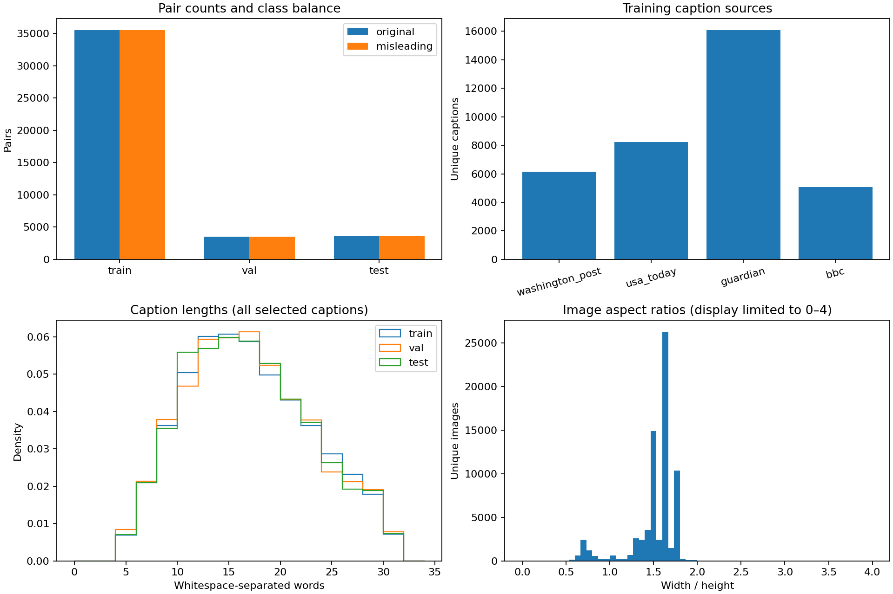

# Exploratory data analysis

Updated 2026-10-27 after full download and independent verification of all 71,966 required VisualNews images. This is descriptive exploration, not new model selection. Original misinformation labels are retained; they are not independent visual-consistency annotations.

## Data and findings

| Split | Pairs | Unique caption IDs | Unique image IDs | Median caption words |
| --- | ---: | ---: | ---: | ---: |
| Train | 71,072 | 35,536 | 59,876 | 16 |
| Validation | 7,024 | 3,512 | 5,943 | 16 |
| Test | 7,264 | 3,632 | 6,147 | 16 |

- Every split has equal original/misleading pair counts. This does not imply balanced source or topic distributions.
- Captions range from 5 to 30 whitespace-separated words; their 95th percentile is 28 words in every split. None of the selected unique captions exceed CLIP's 75-content-token budget. This applies to these benchmark captions, not arbitrary app uploads.
- Training caption sources: Guardian 16,087 (45.27%), USA Today 8,228 (23.15%), Washington Post 6,158 (17.33%), BBC 5,063 (14.25%). These are unique caption counts, not independent article counts. Source/topic metadata enables further robustness analysis; these counts alone do not establish source bias in the classifier.
- Image dimensions cover all 71,966 unique images; percentile statistics and source/topic counts are in `metrics.json`. Aspect ratios vary, so resizing/cropping can remove or distort visible content. The chart displays aspect ratios in 0–4.
- A seeded six-pair training gallery is saved locally at `outputs/eda/training_examples.png`. It includes dataset labels and IDs, not independent factual verdicts. News images remain excluded from GitHub. It is illustrative, not a representative error sample.

## Existing exploratory work

- [Dataset audit](../data_audit.json): split checks and identifier overlap.
- [Image acquisition audit](../visualnews_download_audit.json): complete coverage and integrity.
- [Similarity distributions](../baseline/similarity_distributions.png): overlap between original and misleading pair scores.
- [Similarity-group error analysis](../similarity_analysis/README.md): classifier errors and class mix; this is post-modelling diagnostics, not pure EDA. Its text describes the historical test-reserved stage.
- [VERITE image audit](../verite/image_audit.json): external dataset coverage.

## New encoder compatibility finding

On 64 validation images selected randomly with seed 42, current standard OpenAI CLIP ViT-B/32 image preprocessing gives mean cosine agreement **0.982078** and minimum **0.856282** with the official cached image embeddings. The prespecified >0.999 agreement check fails. See [full parity record](../encoder/visualnews_image_parity.json) for sample IDs, image/checkpoint hashes, preprocessing and per-image similarities.

This is feature agreement, not classification accuracy. It does not invalidate the recorded cached-feature benchmark results, but fresh app/VERITE features cannot be described as numerically equivalent to the training features. Existing app predictions are therefore subject to a feature-distribution mismatch. Do not silently replace preprocessing or overwrite models.

Inspection of the official training repository's [CLIP config](https://github.com/g-luo/news_clippings_training/blob/master/configs/models/clip.yaml) shows square 256×256 resizing followed by a 224×224 crop, unlike the current standard aspect-preserving resize. This is a lead, not proof of how the released cached embeddings were generated. Exact extraction provenance and a fixed, validation-only preprocessing diagnostic remain to be established. Before stronger-encoder training, choose and record one consistent extraction pipeline across train, validation, test and app; historical test outcomes remain follow-up research.

## Reproduce

`.venv/bin/python scripts/visualnews_eda.py`

Requires the verified local metadata/image subset, existing official cached validation features, and the local CLIP checkpoint. Generates descriptive charts, local examples and a validation-only image-feature check. It neither retrains models nor changes app configuration.

Follow-up: [six-variant preprocessing diagnosis](../encoder/PREPROCESSING_DIAGNOSIS.md) found no matching variant. Upstream square resizing worsens agreement; it is not a confirmed correction.
