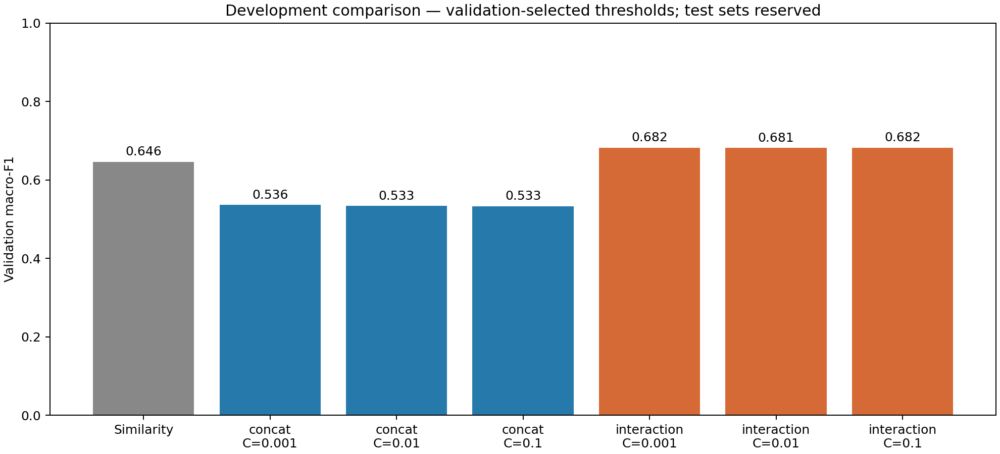

# Logistic regression — development comparison

Trained on 71,072 NewsCLIPpings pairs; selected features, regularisation, and threshold on 7,024 validation pairs. Both test datasets remain reserved. These scores are optimistic development estimates, not final test results or evidence of performance on real-world misinformation.

## Method

Use official SHA256-verified CLIP ViT-B/32 vectors, L2-normalised separately for image and text. Fit StandardScaler on training features only. Compare concatenation `[v;t]` against interaction features `[v;t;abs(v-t);v*t;cos(v,t)]` (1,024 versus 2,049 features). Train L2-regularised logistic regression with `C` in `{0.001, 0.01, 0.1}`, LBFGS, tolerance 1e-5, maximum 1,000 iterations, and two CPU threads. All six candidates converged. Select each decision threshold by validation macro-F1, then select the best candidate. The selected model uses interaction features and C=0.1 (284 iterations).

## Results

| Model | Validation macro-F1 | Accuracy | OOC precision | OOC recall |
| --- | ---: | ---: | ---: | ---: |
| Similarity baseline | 64.58% | 64.69% | 63.18% | 70.44% |
| Best concatenation LR (C=0.001) | 53.62% | 53.64% | 53.81% | 51.42% |
| Selected interaction LR (C=0.1) | **68.23%** | **68.25%** | **69.35%** | **65.40%** |

The macro-F1 improvement over similarity is **3.65 percentage points**. It comes with lower recall: validation false alarms fall from 1,442 to 1,015, while missed misleading pairs rise from 1,038 to 1,215. The selected LR model's validation ROC-AUC is 0.7531. Its default decision threshold yields macro-F1 0.6810, versus 0.6823 after threshold selection.



Concatenation alone is a weak baseline here. A linear model over concatenated features adds separate image and caption contributions; explicit products, differences, and cosine similarity make relationships available to the classifier. This result supports investigating interactions, but does not establish that every interaction feature is necessary or that gains will persist on held-out data.

Regularisation differences among the interaction candidates are small (0.6820, 0.6812, 0.6823). Do not claim C=0.1 is meaningfully superior without further evidence. No statistical-significance claim is made.

## Reproduce and reuse

```bash
.venv/bin/python -m unittest discover -s tests -v
.venv/bin/python scripts/train_logistic.py
```

Metrics and input hashes: `reports/logistic/metrics.json`. Numeric model parameters and validation predictions: ignored `artifacts/logistic/`. The decision rule is `-decision < threshold_on_negative_decision`. The saved threshold is not a probability. `predict_saved` accepts already L2-normalised CLIP vectors and reproduces sklearn's float32 scaling. All 7,024 saved validation predictions were checked against reloaded numeric parameters. Never use arbitrary pickle files as models.

Next: a small MLP with controlled validation-based selection and multiple seeds. Keep final test evaluation until model choices are fixed. Uploaded-image inference still requires verifying encoder/preprocessing compatibility with the released embeddings.
