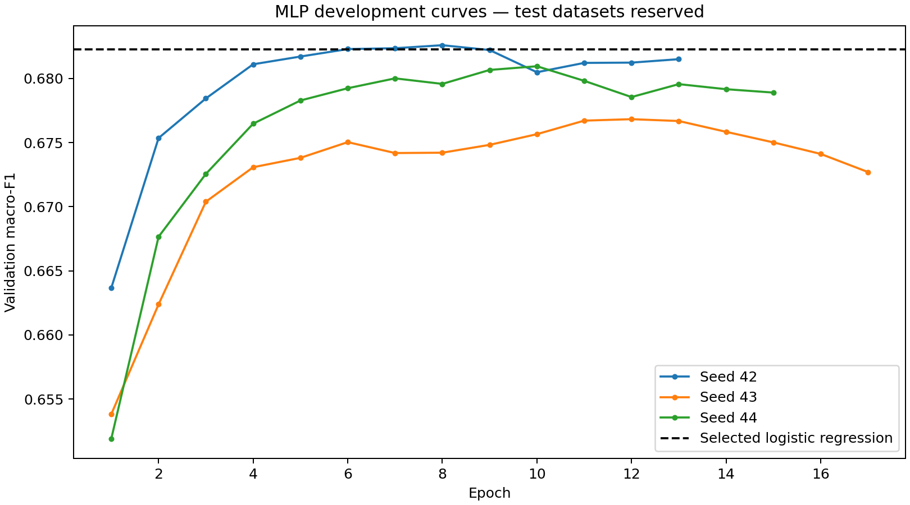

# Small MLP — development study

Architecture: 2,049 interaction features → 32 ReLU units → one sigmoid output. CLIP remains frozen. Train-only StandardScaler, Adam learning rate 0.0003, L2 alpha 0.001, batch size 512. Up to 30 epochs, stopping after five epochs without an increase in validation macro-F1. Restore the best validation epoch per seed. Seeds 42, 43, and 44 were fixed before training; seed 42 was designated as the provisional artifact, not chosen after comparing seeds.

Labels, ground-truth context, and IDs are never predictor inputs. Thresholds and epochs are selected on validation data; both test datasets remain reserved. These are optimistically selected development results.

| Seed | Selected epoch | Macro-F1 | Accuracy | OOC precision | OOC recall |
| --- | ---: | ---: | ---: | ---: | ---: |
| 42 | 8 | 68.26% | 68.27% | 68.82% | 66.80% |
| 43 | 12 | 67.68% | 67.68% | 67.73% | 67.54% |
| 44 | 10 | 68.10% | 68.10% | 68.15% | 67.94% |

Mean validation macro-F1: **68.01%**; sample standard deviation across seeds: **0.30 percentage points**. This standard deviation is not a confidence interval.

Logistic regression achieved 68.23% validation macro-F1. Seed 42 achieves 68.26%, a difference of only about 0.03 percentage points; the MLP average is lower at 68.01%. This experiment does not establish a reliable MLP advantage. The simpler logistic regression remains a sensible provisional deployment candidate.

The seed-42 MLP catches slightly more misleading pairs than logistic regression, but has more false alarms. Its recall remains below the similarity baseline's 70.44%. A more complex model has not eliminated the precision/recall trade-off.

Training loss continues to fall after validation macro-F1 levels off or declines. This is consistent with overfitting and motivates restoring earlier checkpoints; it does not justify selecting models using test data.



## Reproduce

```bash
.venv/bin/python -m unittest discover -s tests -v
.venv/bin/python scripts/train_mlp.py
```

Numeric weights, training-fitted scaler parameters, thresholds, and per-seed validation predictions are stored under ignored `artifacts/mlp/`. Full metrics, histories, and input hashes are in `metrics.json`. Reloaded parameters reproduce all 7,024 validation predictions for each seed. Float64 comparisons preserve threshold boundaries for float32 neural-network outputs. Ten automated tests passed.

## Next decision

Compare validation precision/recall operating points, then freeze the candidate models and thresholds before final test evaluation. Do not interpret sigmoid outputs as calibrated confidence. Encoder/preprocessing compatibility and missing external-test images still require resolution before an upload app and full evaluation can be claimed ready.
