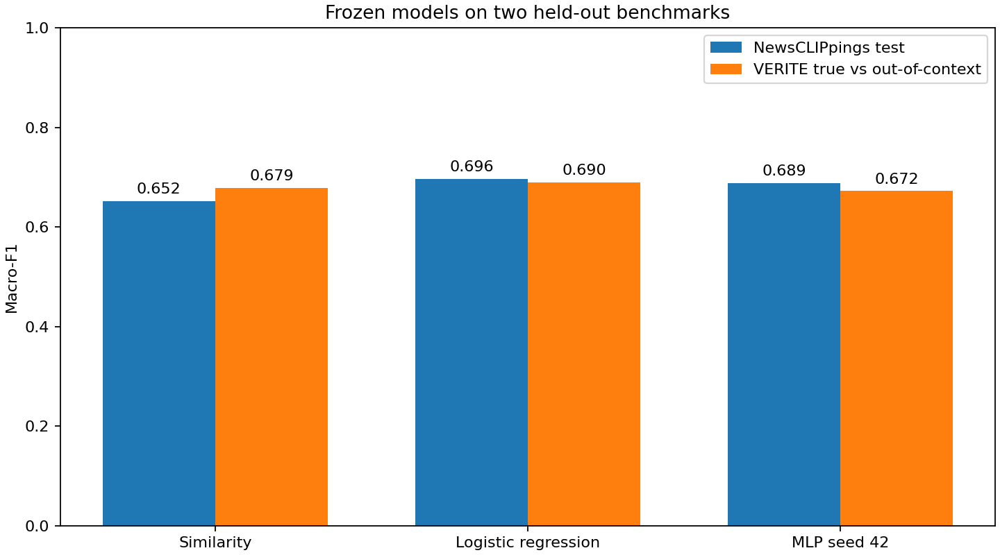

# Frozen NewsCLIPpings test results

All 7,264 test pairs (3,632 per class) were scored with unchanged training-fitted models and validation-selected thresholds. No VERITE result was used to alter these models.

| Model | Accuracy | Macro-F1 | 95% macro-F1 interval | OOC precision | OOC recall |
| --- | ---: | ---: | --- | ---: | ---: |
| Similarity | 65.31% | 65.19% | 64.25%–66.12% | 63.69% | 71.23% |
| Logistic regression | 69.66% | 69.63% | 68.61%–70.61% | 70.84% | 66.82% |
| MLP seed 42 | 68.86% | 68.86% | 67.85%–69.87% | 68.98% | 68.56% |
| MLP seed 43 | 68.75% | 68.75% | 67.72%–69.72% | 68.54% | 69.33% |
| MLP seed 44 | 68.53% | 68.53% | 67.48%–69.53% | 68.58% | 68.39% |

Intervals use 2,000 grouped bootstrap draws: 2994 connected groups of shared VisualNews IDs; largest group 8 pairs. This preserves known content reuse, but cannot identify unrecorded content duplication.

| Model | Macro-F1 change vs similarity (percentage points) | Paired 95% interval (percentage points) |
| --- | ---: | --- |
| Logistic regression | +4.45 | +3.47 to +5.41 |
| MLP seed 42 | +3.67 | +2.65 to +4.68 |
| MLP seed 43 | +3.56 | +2.51 to +4.56 |
| MLP seed 44 | +3.34 | +2.30 to +4.37 |

MLP seed 42 remains the predesignated model. Other seeds describe variability and must not be selected by these scores. These intervals concern this benchmark and frozen models; they do not establish factual verification of arbitrary uploads.

The test split is now evaluated. Do not tune on these results and then describe it as untouched. VERITE evaluates a different distribution and label construction; cross-dataset comparisons are descriptive. 5Pils-OOC remains unscored.

Reproduce with `.venv/bin/python scripts/evaluate_newsclippings_test.py`. Full per-class metrics, confusion matrices and ranking metrics are in `metrics.json`; hashes and thresholds are in `frozen_manifest.json`. Row-level predictions remain in ignored `artifacts/newsclippings_test/`.
