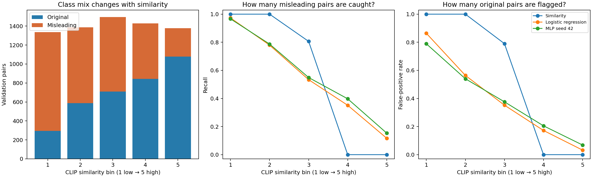

# Does CLIP similarity explain validation errors?

## Method

This descriptive analysis uses existing predictions for all 7,024 NewsCLIPpings validation pairs. No models, weights, or prediction thresholds changed. Both test datasets remain reserved. Bins use the 20th/40th/60th/80th percentiles of **training** cosine similarity: 0.25636, 0.28509, 0.30460, 0.32568. Validation counts are therefore not exactly equal. Bins are left-inclusive at internal cutoffs.

CLIP similarity is a model-derived proxy, not independently labelled semantic compatibility. Models already use this score or related embeddings, so this is a diagnostic association rather than independent validation of compatibility or a causal explanation.

## Findings

| Similarity group | Original pairs | Misleading pairs | Logistic misleading recall | MLP seed-42 misleading recall |
| --- | ---: | ---: | ---: | ---: |
| 1 — lowest | 294 | 1,042 | 97.31% | 96.64% |
| 2 | 587 | 799 | 77.97% | 78.72% |
| 3 | 710 | 785 | 53.38% | 54.90% |
| 4 | 843 | 586 | 35.15% | 39.76% |
| 5 — highest | 1,078 | 300 | **11.67%** | **15.33%** |

In group 5, logistic regression catches 35 of 300 misleading pairs and misses 265. It falsely flags 35 of 1,078 original pairs. The MLP catches 46 misleading pairs and falsely flags 74 original pairs. High similarity is associated with many missed misleading pairs under the existing decision rules.

Low similarity is not universally easy: in group 1, logistic regression catches 97.31% of misleading pairs but also incorrectly flags **86.39% of original pairs**. The corresponding MLP false-positive rate is 78.91%. Both types of error matter.

### Why subgroup accuracy can mislead

Logistic regression's accuracy in group 5 is **78.23%**, despite its 11.67% misleading recall. Most pairs in this group are original. Its balanced accuracy is only **54.21%**. Always predicting original would also achieve 78.23% accuracy in this group. Therefore, do not interpret its subgroup accuracy as successful misinformation detection.

The similarity baseline catches no misleading pairs in groups 4 and 5 because all their scores exceed its fixed threshold. It flags every pair in groups 1 and 2. This follows directly from its decision rule, not from an independently discovered property of semantic correctness.

### Paired comparison

Each of 3,512 validation captions has one original and one generated misleading image pairing. The original pairing has higher CLIP similarity in **59.40%** of these matched comparisons; the misleading pairing has equal or higher similarity in **40.60%**. This is a paired ranking statistic, not binary-classification accuracy.



## Interpretation and limits

The results support a precise claim: **at the selected operating points, high-CLIP-similarity misleading pairs are frequently missed; low-similarity original pairs are frequently falsely flagged.** They do not establish that dates/locations cause those errors, that external evidence will fix them, or that the model accurately measures human semantic compatibility. Original VisualNews content is still needed for detailed visual/contextual inspection.

The validation set has already selected models and thresholds. This analysis is exploratory, not a final generalisation estimate. No compatibility labels were invented and no original misinformation labels were changed. Report class counts and both recall and false-positive rate instead of comparing subgroup accuracy alone.

## Reproduce

```bash
.venv/bin/python -m unittest discover -s tests -v
.venv/bin/python scripts/analyse_similarity.py
```

Requires the existing baseline, logistic-regression, and seed-42 MLP prediction artifacts. The script checks row alignment against validation annotations, verifies uniqueness of caption/label keys for MLP alignment, and reconciles binned confusion counts with whole-validation counts. Input hashes, complete per-bin metrics, and the chart are retained here. No new dependencies are required.
