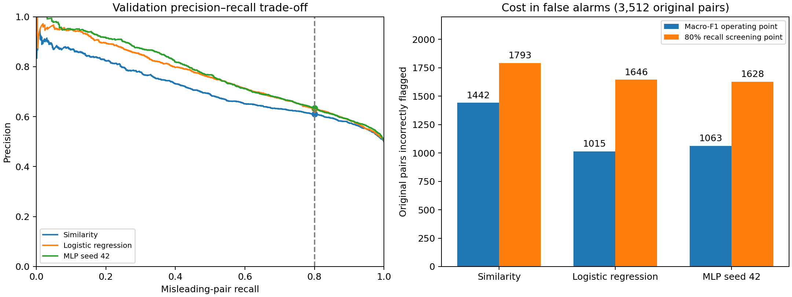

# Screening thresholds: a validation-only trade-off study

Purpose: assess a proposed global 80% misleading-recall operating point. Model weights and existing saved thresholds were not changed; neither test dataset was accessed. The proposed target was set before this analysis.

For each model, select the highest inclusive score threshold that reaches at least 80% recall on validation. This minimises the number of flags among thresholds satisfying that target, retaining ties. It does not necessarily maximise precision. Scores are negative cosine similarity, logistic decision score, and the uncalibrated MLP sigmoid output, respectively. Each model has one global threshold; no subgroup-specific tuning occurs.

## Results

| Model | Mode | Recall | Precision | Original false-positive rate | Macro-F1 | High-similarity misleading recall |
| --- | --- | ---: | ---: | ---: | ---: | ---: |
| Similarity | macro_f1 | 70.44% | 63.18% | 41.06% | 64.58% | 0.00% |
| Similarity | screening_80 | 80.01% | 61.05% | 51.05% | 63.60% | 0.00% |
| Logistic regression | macro_f1 | 65.40% | 69.35% | 28.90% | 68.23% | 11.67% |
| Logistic regression | screening_80 | 80.01% | 63.06% | 46.87% | 65.96% | 28.67% |
| MLP seed 42 | macro_f1 | 66.80% | 68.82% | 30.27% | 68.26% | 15.33% |
| MLP seed 42 | screening_80 | 80.01% | 63.32% | 46.36% | 66.24% | 33.33% |

The validation set has 3,512 pairs per class. Reaching the target requires catching at least 2,810 misleading pairs (80.01% after integer rounding). The high-similarity subgroup is unchanged: scores at or above the training 80th percentile, with 300 misleading pairs and 1,078 original pairs.

- Logistic regression catches 513 additional misleading pairs, but falsely flags 631 additional original pairs. High-similarity detections increase from 35 to 86 out of 300.
- MLP seed 42 catches 464 additional misleading pairs, but falsely flags 565 additional original pairs. High-similarity detections increase from 46 to 100 out of 300.
- The similarity baseline still misses all 300 high-similarity misleading pairs at this global screening target; overall recall does not ensure subgroup recall.



## Recommendation

Threshold adjustment improves sensitivity but does not resolve the observed detection weakness. At the screening setting, almost half of original validation pairs are flagged, and most high-similarity misleading pairs are still missed. These settings are research candidates for a human-review screening mode, not validated misinformation verdicts. Do not silently replace the main macro-F1 operating points or claim that the problem is solved.

The MLP makes slightly fewer false alarms than logistic regression at the selected screening target, but this development comparison does not establish statistical superiority. Precision also depends on the prevalence of misleading examples; the balanced benchmark does not establish real-world warning reliability.

All operating points are selected and measured on the same validation data and are optimistic. The 80% recall target is not guaranteed on new data. A richer evidence-assisted model is a separate experiment, requiring genuine retrieved evidence, leakage checks, and a development split; never use ground-truth captions/context as predictor evidence or tune on 5Pils-OOC. No evidence-assisted model was trained here.

## Reproduce

```bash
.venv/bin/python -m unittest discover -s tests -v
.venv/bin/python scripts/compare_thresholds.py
```

Complete metrics, thresholds, score definitions, and provenance hashes are in `metrics.json`. Existing model artifacts remain unchanged. Fifteen tests passed, including checks that the screening threshold meets the target with the fewest flags and handles tied scores correctly.
