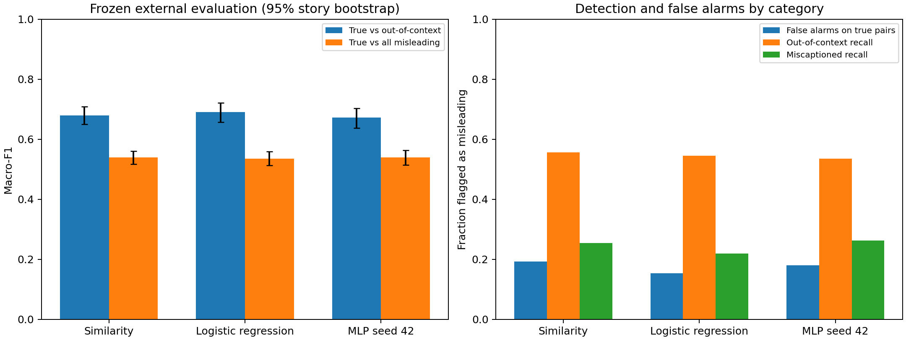

# Frozen VERITE external evaluation

Models, scalers, and thresholds were selected on NewsCLIPpings train/validation and frozen before VERITE scoring. Fresh features use standard OpenAI CLIP ViT-B/32 preprocessing. No training, calibration, or threshold optimisation used VERITE.

## Primary task: true versus out-of-context

338 true pairs and 325 out-of-context pairs (663 total). Positive means out-of-context. MLP seed 42 was designated before evaluation; the other seeds describe training variability.

| Model | Accuracy | Macro-F1 | 95% macro-F1 interval | OOC recall | False-alarm rate | ROC-AUC |
| --- | ---: | ---: | --- | ---: | ---: | ---: |
| Similarity | 68.48% | 67.86% | 65.00%–70.93% | 55.69% | 19.23% | 0.7628 |
| Logistic regression | 69.83% | 69.00% | 65.75%–72.17% | 54.46% | 15.38% | 0.7645 |
| MLP seed 42 | 68.02% | 67.23% | 63.78%–70.33% | 53.54% | 18.05% | 0.7549 |
| MLP seed 43 | 65.46% | 64.52% | 61.25%–67.93% | 50.15% | 19.82% | 0.7223 |
| MLP seed 44 | 68.33% | 67.98% | 64.62%–71.33% | 59.08% | 22.78% | 0.7470 |

## Secondary task: true versus all misleading

338 true, 338 miscaptioned and 325 out-of-context pairs (1,001 total). Both misleading categories map to the positive class; this is not three-class classification.

| Model | Accuracy | Macro-F1 | OOC detected / 325 | Miscaptioned detected / 338 | False alarms / 338 |
| --- | ---: | ---: | ---: | ---: | ---: |
| Similarity | 53.95% | 53.94% | 181 | 86 | 65 |
| Logistic regression | 53.65% | 53.59% | 177 | 74 | 52 |
| MLP seed 42 | 53.95% | 53.94% | 174 | 89 | 61 |
| MLP seed 43 | 51.55% | 51.52% | 163 | 82 | 67 |
| MLP seed 44 | 55.04% | 55.01% | 192 | 98 | 77 |



## Variability and interpretation

- primary_true_vs_ooc: three-seed MLP macro-F1 mean 66.58%, sample SD 1.82 percentage points. This SD is not a confidence interval.
- secondary_true_vs_all_misleading: three-seed MLP macro-F1 mean 53.49%, sample SD 1.79 percentage points. This SD is not a confidence interval.

Intervals use 2,000 bootstrap draws of entire stories (seed 42), keeping related image-caption examples together. They quantify sampling variability conditional on each frozen model; they do not include preprocessing uncertainty. Overlapping intervals or point estimates alone do not establish statistical superiority.

The all-misleading task has 66.23% positive prevalence. An always-misleading classifier therefore obtains 66.23% accuracy, but only about 39.84% macro-F1; accuracy alone is insufficient. The primary task is approximately balanced.

These are external-transfer results, not a reproduction of RED-DOT. The original released annotation file contains 1,001 rows despite the documentation headline of 1,000. Text feature parity is supported; image parity with NewsCLIPpings is unverified and RED-DOT image feature agreement is partial. The models do not retrieve evidence about dates, locations, or events.

VERITE has now been evaluated. Further development must not tune against these results and then describe the same set as untouched. NewsCLIPpings test and other reserved datasets were not evaluated by this script.

## Reproduce and inspect

```bash
.venv/bin/python scripts/evaluate_verite.py
.venv/bin/python scripts/report_verite.py
```

See `frozen_manifest.json` for model, checkpoint, image and annotation hashes and frozen thresholds. `metrics.json` includes per-class precision/recall/F1, confusion matrices (rows=true labels, columns=predictions; order true, misleading), ranking metrics and intervals. Local row-level predictions and normalised features are in ignored `artifacts/verite/`. Original model artifacts are unchanged.
